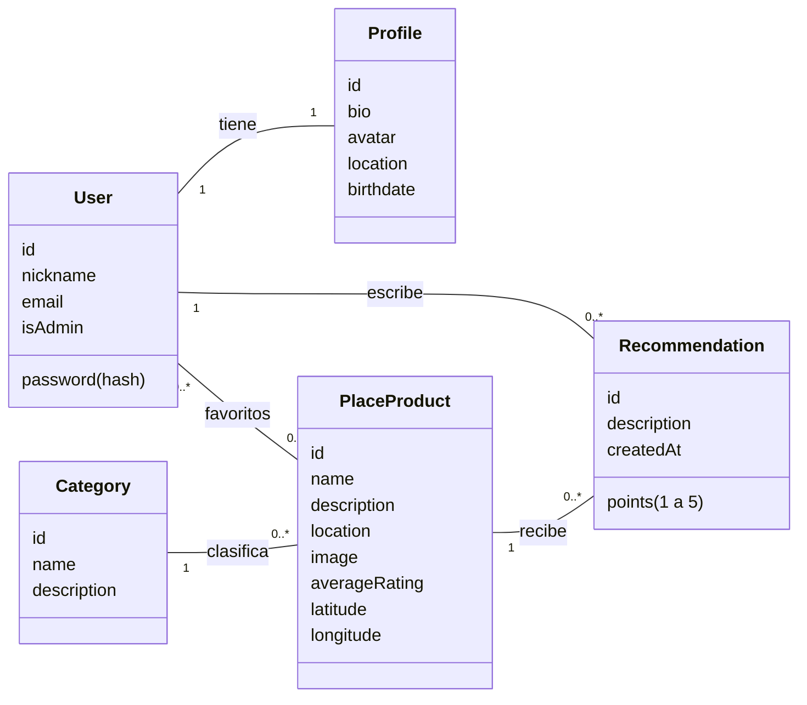

# Propuesta TP DSW

## Grupo

### Integrantes
- 51742 - Quaglia, Mateo

### Repositorios
- [Frontend](https://github.com/Enderking81/frontendDiscoverIt)
- [Backend](https://github.com/Enderking81/backendDiscoverIt)

## Tema

### Descripción
DiscoverIt es una plataforma para descubrir lugares de Rosario: restaurantes, museos, bares, parques y más. Cualquier visitante puede explorar los lugares, filtrarlos por categoría, buscarlos por nombre o dirección y verlos en un mapa. Los usuarios registrados recomiendan lugares con un puntaje de 1 a 5 y una opinión, y con esas recomendaciones se calcula el rating de cada lugar. También pueden guardar lugares en favoritos. Un administrador gestiona las categorías y los lugares publicados.

### Modelo

## Alcance Funcional

### Alcance Mínimo

Regularidad:
|Req|Detalle|
|:-|:-|
|CRUD simple|1. CRUD Category|
|CRUD dependiente|1. CRUD PlaceProduct {depende de} CRUD Category|
|Listado + detalle|1. Listado de lugares filtrado por categoría y por texto (nombre o dirección) => detalle con descripción, ubicación en el mapa, rating promedio y recomendaciones|
|CUU/Epic|1. Recomendar un lugar|

Adicionales para Aprobación:
|Req|Detalle|
|:-|:-|
|CRUD|1. CRUD Category 2. CRUD PlaceProduct 3. CRUD User (registro, perfil, edición y baja de la cuenta) 4. CRUD Profile 5. CRUD Recommendation {depende de} CRUD User y CRUD PlaceProduct|
|CUU/Epic|1. Publicar un lugar (administrador) 2. Recomendar un lugar (usuario) Están relacionados: el lugar que publica el administrador es lo que el usuario recomienda, y cada recomendación recalcula el rating del lugar.|

### Alcance Adicional Voluntario

|Req|Detalle|
|:-|:-|
|Listados|1. Mis favoritos 2. Panel de administración con estadísticas del sistema|
|CUU/Epic|1. Guardar un lugar en favoritos|
|Otros|1. Mapa interactivo de los lugares 2. Moderación: el administrador puede eliminar cualquier recomendación 3. Modo oscuro|

## Niveles de acceso

|Nivel|Puede|
|:-|:-|
|Invitado|Explorar, filtrar y ver el detalle de los lugares|
|Usuario|Lo anterior, más recomendar lugares, editar o borrar sus recomendaciones, gestionar favoritos y su perfil|
|Administrador|Lo anterior, más gestionar categorías y lugares, ver estadísticas y moderar recomendaciones|
